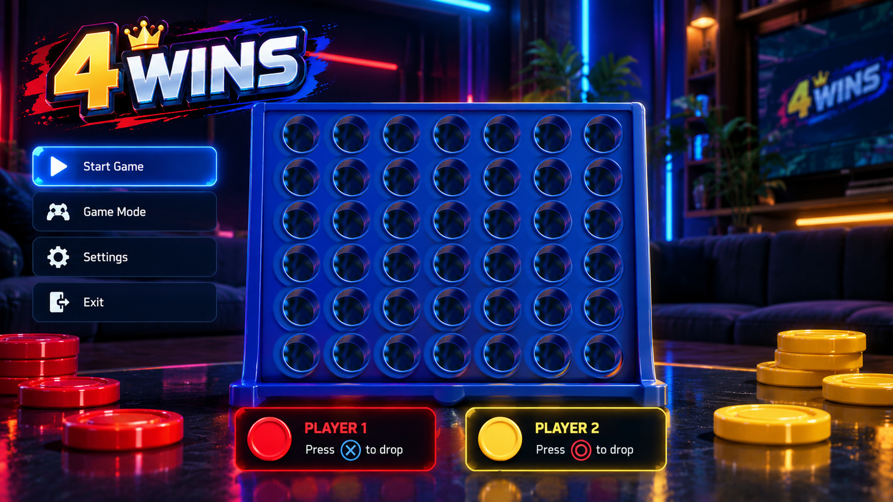

# 4 WINS for PS5 — v0.1.1

An offline Connect Four game for jailbroken PS5 consoles. **by YAHBALLON**.

## What's fixed in v0.1.1
- Restores the neon-lounge **photographic visual** from the supplied reference, with an empty board. No more low-detail generated room.
- Proper focus states: all four home-menu buttons repaint over the original photograph rather than overlapping baked labels. Modal settings live to the **right of the board** instead of obscuring columns.
- Navigation through **`Yahballon/ps5-homebrew-ui`** `InputTracker`: held D-pad and analog stick repeat reliably, short taps are not lost.
- Separate Start / Mode / Difficulty / Settings / Playing / Pause / Result / Exit screens. Options pauses; D-pad navigates pause and results; no invisible selection.
- Bottom player indicator adapts to Human/Human and Human/Bot; score, bot state, column indicator and drop animation.
- Real transparent red/yellow game chips, animated down onto the 7×6 board. No duplicate chips printed into the scene.
- Save settings under `/data/4WINS/settings.ini`; diagnostics `/data/4WINS/logs/4wins.log`.

## Modes
- 2 players locally sharing one DualSense (take turns with X).
- 1 player vs AI: Easy (random), Medium (tactical), Hard (minimax/alpha-beta).

## Controls
| Screen | Controls |
| --- | --- |
| Main menu | D-Pad up/down or left stick, X select, Circle exit prompt |
| Mode / Difficulty / Settings | D-Pad up/down, X confirm, Circle back; Settings left/right modify |
| Game | D-Pad left/right or left stick choose column, X drop, L1/R1 first/last column, OPTIONS pause |
| Pause | Up/down choose Resume, Restart, Main Menu; X confirm; Circle/OPTIONS resume |
| Result | Up/down choose Rematch / Main Menu; X confirm, Circle return |

## Build
Source: `homebrew/4wins` in `Yahballon/tmp_lap`. GitHub workflow builds using **Yahballon/ps5-homebrew-ui** OpenGL renderer, `ps5-payload-sdk`, the pinned PS5 OpenGL SDK, and PS5-DevBridge packaging. Every successful release produces `PPSA99858.zip` under tag `4wins-v0.1.1`, which is discovered automatically by TESTBUILDS `version.json`.

Host tests: `g++ -std=c++20 -O2 -Wall -Wextra -Werror homebrew/4wins/tests/controls_test.cpp -o /tmp/test && /tmp/test`.

> Console screenshot is the desired visual target; playability and rendering must be confirmed on actual PS5 hardware, not inferred solely from CI.
