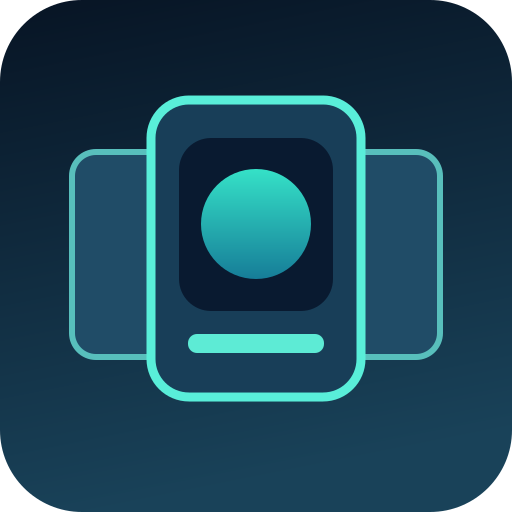

# AndroidFlow

**APK Coverflow for PS5 · by YAHBALLON**

> **AndroidFlow v0.1.4 — Fruity Game ARM64 longjmp compatibility fix (experimental).** The full PS5 v0.1.3 log proves that the game aborts at Hydroid's unsupported host longjmp. v0.1.4 enables the existing native ARM64 jump handler specifically for Fruity Game; success after the scene transition still needs a real PS5 retest. Previously: v0.1.2 is released but console diagnostics can be missing when the /app0 directory is not writable. v0.1.3 fixes file logging; requires a successful new native build and hardware test. Previously: v0.1.1 displays Fruity Game on PS5 but leaves cursor trails and crashes when Play is clicked. Changes below require real console validation.

AndroidFlow uses [Hydroid](https://github.com/ZiZc3/Hydroid)'s ARM64 Android game runtime, built-in APK metadata/icon extraction and per-game saves. The visual browsing style is adapted from the GPL GBAXY coverflow layout in [PS5GBAX](https://github.com/Yahballon/PS5GBAX). All game assets come from user-owned Android packages; none are distributed with AndroidFlow.

## What is implemented in source

- Native full-screen 1920x1080 animated card coverflow with a larger focused card and angled neighbors.
- Detect .apk, .xapk, .apks and .apkm packages; display game names and embedded app icons using Hydroid's parser and cache.
- A single title can select among multiple packages and feed the chosen path to Hydroid's existing run_apk function.
- D-pad/left-stick browse, L1/R1 jump by five, Cross start, Triangle library rescan, Circle exit.
- Distinct experimental Title ID PPSA99920 with its own persistent library/cache root.

### In-game Godot 3 touch controls (v0.1.3)

- **Right stick** moves the native cursor; **Cross (✕)** taps/holds at that position. Hold Cross while moving to drag. Cross no longer also sends Enter+gamepad A while cursor mode is on.
- **DualSense touchpad:** touch or swipe to emulate the Android touchscreen at the equivalent location. Lift the finger to release.
- **R3** toggles between touch-cursor mode (default) and native gamepad mode; only in gamepad mode does Cross forward normal Godot gamepad A/Enter. Hold **Options** for Hydroid's Quick Menu.
- Godot 3.2 old JNI `touch(int[])` and Godot 3.5 modern JNI `touch(float[])` both have dedicated bridges. No screen-size stretching beyond Hydroid's current 1920x1080 viewport support.
- **PS5 report:** Fruity Game v0.1.1 renders at 60 FPS, but clicking Play crashes and cursor movement leaves trails. v0.1.2 adds a state-preserving full-frame clear to remove old cursor overlays, prevents duplicate Cross activation and traces the first frames after releasing touch. **The Play crash is not confirmed fixed without a console log and retest.**

The current library scans up to 64 files across:

    /data/homebrew/PPSA99920/game/
    /mnt/usb0/Android/
    /mnt/usb1/Android/
    /data/AndroidFlow/apks/

USB permissions and paths depend on your jailbreak and loader. Scanning is synchronous in this version. Returning from an Android game to choose a different one requires restarting the launcher.

### Fruity Game crash analysis — v0.1.4

PS5 console log from v0.1.3 shows:

    setjmp(0x1026bfae88, ...) -> 0
    longjmp(1): not supported for ARM64 code, stopping
    CRASH signal 6

Hydroid has ARM64-native setjmp/longjmp routines in `src/arm_imports.c`, already used by Candy Crush, but not previously enabled for `page.codeberg.marshreaper.fruitygame`. The default host `linux_abi.c:l_longjmp()` intentionally aborts. AndroidFlow v0.1.4 whitelists this one package, preserving all other APK behavior. The existing guest routines save/restore x19–x30, SP and d8–d15 in the game's ARM jump buffer.

The new `/data/AndroidFlow/logs/android.log` should show `androidflow: ARM64-native setjmp enabled for Fruity Game` and `androidflow: ARM64-native longjmp enabled for Fruity Game` during library loading. This verifies the correct import path. It does **not** prove the game will run successfully without a console test: there may be other unsupported APIs or faults.

### Logs and reproducing a Godot crash

AndroidFlow v0.1.3 first creates **/data/AndroidFlow/logs/android.log**, a persistent FTP-visible log independent of a possibly read-only /app0 mount. A native fault writes **/data/AndroidFlow/logs/crash.txt** directly. These paths use /data and normally survive restarting AndroidFlow. If /data is not writable it falls back to upstream /app0/android.log and /app0/trace.txt.

For an immediate workaround in old versions, stream Hydroid logs to a Windows PC via its built-in TCP log server:

    python3 live_log.py --host YOUR_PS5_IP --all

The script is from Hydroid's tools/live_log.py; run it while the app is open. Logs get saved locally under logs/live-YYYYMMDD-HHMMSS.log. The console log file **may be absent** in v0.1.0–v0.1.2; do not assume a copy exists. If both /data and /app0 fail to open writable logs, the app prints an error through TCP 9025.

In v0.1.3 Godot touch DOWN/UP flushes diagnostic lines before/after JNI dispatch, so a process crash is more likely to leave useful evidence. The crash at Fruity Game PLAY has not been conclusively diagnosed or fixed by this logging change.

## Compatibility reality

Hydroid is not a full Android operating system. At present it targets selected 64-bit ARM Android games whose engine and API calls are implemented. That includes some Unity, Cocos2d-x, Godot, Unreal and NativeActivity games. Many other Android apps, especially pure Java/Kotlin or 32-bit-only packages, will not work. Google Play services and arbitrary APK installation aren't provided. Launching a given game is unverified until tested on PS5.

## Build

See upstream [Hydroid BUILD.md](https://github.com/ZiZc3/Hydroid/blob/main/BUILD.md) first. This requires the Android NDK r27c, PS5_Vulkan/native payload toolchain, ps5-opengl, Dynarmic, FFmpeg for PS5 and other build dependencies. They are **not** vendored in this repository.

From an existing local clone of Yahballon/tmp_lap:

    git clone https://github.com/ZiZc3/Hydroid.git /tmp/hydroid-androidflow
    git -C /tmp/hydroid-androidflow checkout --detach d8371afd75e3da6ab888d467d1e6bb00c32d2beb
    python3 -m pip install Pillow
    python3 homebrew/androidflow/tools/apply_overlay.py --source /tmp/hydroid-androidflow
    cd /tmp/hydroid-androidflow
    bash third_party/fetch-boost.sh
    bash title/build-title.sh

The **expected** native output after a successful build is dist/PPSA99920, with eboot.bin, sce_sys/param.json, sce_sys/icon0.png, sce_module/libc.prx, fonts, native dependencies and androidflow.flag. A ZIP of only this source folder is **not** installable. Check output and required dependencies before creating a test release.

The [overlay validation workflow](../../.github/workflows/check-androidflow.yml) passed in run 41590133362 (host math and pinned source patch). A separate [native PS5 build workflow](../../.github/workflows/build-androidflow.yml) now attempts the full pinned Hydroid/RADV/Dynarmic/NDK/FFmpeg toolchain, independently validates the signed PPSA99920 installation ZIP and publishes an immutable release only after a passing main-branch build. The initial v0.1.0 native build passed (GitHub Actions 41596070059). The updated v0.1.1 input bridge needs its own validation. The generated central version.json is intentionally left untouched until there is a verified installable ZIP in a real GitHub Release.

## Visuals & attribution

The standalone logo here is an original, **programmatically drawn** illustration, not an AI-generated icon and not a screen capture. The icon script (assets/generate_icon.py) outputs the actual 512x512 sce_sys/icon0.png during the overlay. A genuine screenshot is pending PS5 or host rendering.

- Hydroid source and runtime: ZiZc3, GPL-3.0, with its original licensing and required dependency notices.
- GBAXY/PS5GBAX coverflow geometry: GPL-3.0-or-later.
- AndroidFlow integration: YAHBALLON, GPL-3.0-or-later.

**Development handoff:** [MILESTONES.md](MILESTONES.md).
