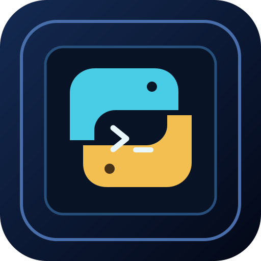

# PS5 MicroPython

**Native PS5 Homebrew · by YAHBALLON · v0.1.0**

Run small Python scripts from a PS5 homebrew application using the
official [MicroPython](https://github.com/micropython/micropython)
C embedding port. The interpreter executes inside the PS5 app; a native
TV-friendly OpenGL interface shows output, logs and uncaught exceptions.

The launcher logo is an original vector/procedurally rendered design,
not an AI-generated graphic.

**Status:** PS5 cross-compilation and on-device behavior are not yet verified.
There is no confirmed release download or console screenshot.

## Features

- Real MicroPython VM, bytecode compiler and garbage collection.
- Three packaged Python demonstrations: Hello, Fibonacci and Collections.
- Local custom Python scripts from the writable scripts directory.
- Direct TV output of print statements and Python exceptions.
- Script list refresh, console scroll, clear and diagnostic log.
- Input limits: 64 KiB scripts, 256 KiB interpreter heap and 24 KiB output.

## Controls

| Controller | Action |
| --- | --- |
| D-pad / left stick Up/Down | Select a script |
| Cross | Run the highlighted Python file |
| Triangle | Refresh the list of scripts |
| Square | Clear the console |
| L1 / R1 | Scroll console output |
| Circle | Quit |

## Install and run (after a successful PS5 build)

Use the verified CI-produced PPSA99791.zip, not a GitHub source archive.
Install the complete PPSA99791 folder under /data/homebrew/ using your
existing compatible PS5 homebrew registration method.

To add a script, copy a UTF-8 file such as hello_custom.py to:

    /data/PS5MicroPython/scripts/hello_custom.py

Select Triangle to rescan and Cross to execute it. The application creates
the data and scripts directories on launch; previous scripts are preserved.
Log file:

    /data/PS5MicroPython/logs/runtime.log

Only run Python files you trust; this is a script host, not a security sandbox.

## How the port works

The [GitHub Actions workflow](../../.github/workflows/build-ps5-micropython.yml)
uses the PS5-DevBridge simple-calc native app template and checks out the
MicroPython upstream v1.26.1 release. The official ports/embed generator
creates self-contained C source files. Those files are compiled into the
native PS5 executable, and the embed port's stdout routine is replaced by
our console-output shim. All three sample scripts are bundled as app assets.
The upstream MIT license is included in the resulting install folder.

No PC Python service, SSH daemon, network request or Python installation is
needed at runtime.

## Limitations

This is a minimal MicroPython build, not the full CPython interpreter.
Unix extensions, sockets, pip, arbitrary native extensions, a REPL and a
built-in Python editor are not part of v0.1.0.

**Important:** running scripts blocks the current UI thread until they
complete. An infinite loop may require restarting the app. Script execution
is memory-bounded but is not isolated against deliberate abuse.

A CI success alone will not establish compatibility with PS5 firmware 5.10.
PS5 hardware testing and a real native screenshot are still pending.

## Credits and licensing

Homebrew app and original procedural art: **YAHBALLON**.
App source: GPL-3.0-or-later.
MicroPython: Damien P. George and contributors, MIT License.
See [THIRD_PARTY_NOTICES.md](THIRD_PARTY_NOTICES.md).

**SCREENSHOT: NOT CAPTURED.** No fabricated PS5 hardware screenshot.
