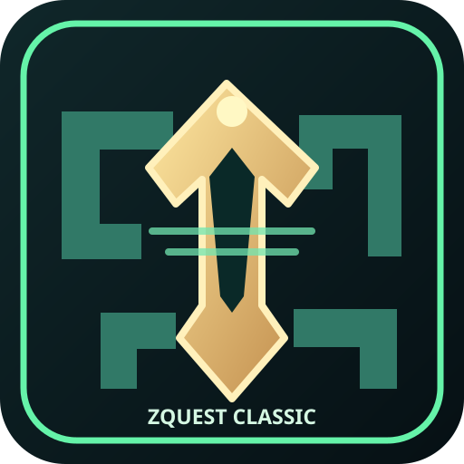

<p align="center"></p>

# ZQuest Classic PS5 — Port Foundation v0.1.5

**Native PS5 homebrew prototype · by YAHBALLON · PPSA99127**

> ⚠️ **Not playable yet.** This is the first-stage quest-browser frontend;
> upstream ZQuest Classic's `zplayer` game engine is not integrated. The
> project is **not** a completed PS5 port of the game.

## What currently works

- Native, controller-friendly 1920 × 1080 UI, not a web wrapper or screenshot.
- Bounded incremental scanning for original/user-supplied `.qst` files using direct PS5 libkernel enumeration, avoiding PS5 bigapp `opendir` failures.
- File list, size, incremental native .qst binary read test with CRC32 and rescanning.
- USB and internal-drive quest locations, subject to firmware/loader permissions.
- English UI, sensible exit confirmation, log at `/data/ZQuestClassic/logs/port.log`.
- PS5 CI cross-compile/package workflow and host + mocked-native libkernel scanner tests.

The program **does not** parse or execute quests, support saves or play music. Cross reads selected file bytes only, and a successful read is not gameplay.
Source icon `assets/icon.svg` and procedurally rendered PS5 icon are original
artwork; they are not AI-generated and use no Nintendo/Zelda artwork. A real
app UI screenshot has not been captured.

For v0.1.5 the native scanner is explicitly enabled in `native/main.cpp`,
without changing the OpenGL SDK's compilation flags. Startup log includes
`SCAN_BACKEND=libkernel-getdents-v0.1.5`; CI verifies this marker in the
packaged binary.

The v0.1.2 on-console logs proved the quest directory opens but native getdents
returned `0x80020016` (EINVAL). v0.1.5 changes the entry buffer from
16 KiB to 64 KiB with 16 KiB alignment, matching the existing PS5GBCX
implementation. Hardware results still need to be verified.

After scanning, the **Options** screen shows opened-folder/error counts. Detailed
`DIR_OK`, `DIR_FAIL`, `DENTS_FAIL`, `QUEST_FOUND`, and `SCAN_DONE`
records are written to `/data/ZQuestClassic/logs/port.log`. A missing USB root is
expected; failures to read an existing internal quest directory are not.

## Where to place quests

Create and populate one of:

```text
/data/ZQuestClassic/quests/
/mnt/usb0/ZQuestClassic/quests/
/mnt/usb1/ZQuestClassic/quests/
/mnt/usb0/quests/
/mnt/usb1/quests/
```

The bundled app also scans `/data/homebrew/PPSA99127/quests/`. Supported
library discovery format: `.qst` (case-insensitive). Finding a filename
does **not** mean the engine can open or run that quest yet.

## Quest file read diagnostics (v0.1.5)

The confirmed v0.1.3 directory scanner lists `.qst` filenames but did
not previously prove that actual quest contents were readable by PS5. The new
`quest_reader.hpp` uses `sceKernelOpen/sceKernelRead/sceKernelClose` to
read the selected file in 32 KiB increments, displaying progress and CRC32.
No file contents are changed, and the game engine is still unavailable.

Read progress and failures are written to
`/data/ZQuestClassic/logs/port.log`. Send `QUEST_READ_FAIL` diagnostics
if pressing X produces an error instead of `READ SUCCESS`.

## PS5 video bridge test (v0.1.5)

Press **Triangle** to show/hide the test-only 256x224 animated pixel pattern
in the right panel. This exercises 6-bit Allegro-style palette conversion,
8-bit indexed pixels, RGBA8 OpenGL texture update and nearest-neighbor
presentation on the native PS5 EGL renderer. **It does not render any
actual quest.** Press Circle to leave the video test without closing the app.

The log will show `PS5_INDEXED_VIDEO_BRIDGE_READY`,
`VIDEO_TEST_ON` and `VIDEO_TEST_OFF`, or
`PS5_INDEXED_VIDEO_BRIDGE_FAILED` if GPU initialization fails.
See [engine/VIDEO_PORT.md](engine/VIDEO_PORT.md). Hardware behavior
still requires on-console confirmation.

## DualSense

| Button | Current action |
| --- | --- |
| D-pad / Left stick Up/Down | Select quest |
| Cross | Read selected .qst bytes and show I/O results (NOT Play) |
| Triangle | Toggle animated indexed-palette PS5 graphics test (NOT gameplay) |
| Square | Rescan quest locations |
| Options | Technical port status |
| Circle | Back / confirm exit dialog |
| Cross in exit dialog | Exit app |

## Building the native prototype

The workflow is [Build ZQuest Classic PS5](../../.github/workflows/build-zquestclassic-ps5.yml).
It clones the PS5-DevBridge `simple-calc` native SDK sample and replaces
its app logic with `native/main.cpp`, `native/quest_index.hpp` and the
native `native/scan_directory.hpp` libkernel scanner. The
workflow builds an actual PS5 ELF then packages `PPSA99127.zip`; only an
observed successful Actions job establishes a valid artifact.

After successful native CI, the **experimental prerelease** can be downloaded from
[ZQuest Classic PS5 v0.1.5](https://github.com/Yahballon/tmp_lap/releases/tag/zquestclassic-ps5-v0.1.5)
and is intentionally included in the TESTBUILDS catalog so the controller-first
library UI can be tested on real hardware. The release is **NOT PLAYABLE**.

The install layout is:

```text
PPSA99127/
  eboot.bin
  sce_sys/param.json
  sce_sys/icon0.png
  sce_module/libc.prx
  assets/fonts/inter-semibold.huifont
```

Place the unpacked `PPSA99127` folder under `/data/homebrew/` with a
compatible authorized homebrew loader. Native PS5 firmware compatibility and
hardware behavior are **not tested** at this stage.

Host validation:

```bash
g++ -std=c++20 -Wall -Wextra -Werror \
  homebrew/zquestclassic-ps5/tests/quest_index_test.cpp -o /tmp/zc-quest-test
/tmp/zc-quest-test
```

## Roadmap and licensing

The actual game engine comes from [ZQuestClassic/ZQuestClassic](https://github.com/ZQuestClassic/ZQuestClassic),
released under **GPLv3**. Porting requires its Allegro 5/Allegro-Legacy
platform support, zplayer linkage, resource files, graphics, sound, gamepad
mapping and real quest gameplay validation. See [PORTING.md](PORTING.md)
for specific integration blockers and acceptance tests.

This prototype's original code is GPL-3.0-or-later. The borrowed
PS5-DevBridge build template retains upstream authorship and license.
No third-party quests or commercial game assets are included.

**Status:** native prototype source available; game engine **not integrated**;
PS5 hardware test **not performed**. Experimental UI test release only;
no playable gameplay release.
